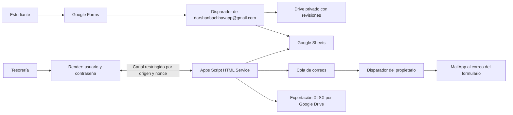

# Arquitectura

Render publica exclusivamente `web-dist/`: HTML, CSS, JavaScript, configuración pública, logotipo y el PDF vacío. No almacena solicitudes, tokens de Google, claves de subsanación ni copias de documentos de estudiantes. `dist/` es un artefacto separado destinado a Apps Script y nunca es la carpeta de publicación de Render.

El backend de Apps Script ejecuta **como propietario** y permite acceso anónimo al servicio web. El panel exige su propia autenticación: el servidor verifica la prueba PBKDF2, crea una sesión opaca y comprueba esa sesión en cada llamada. La identidad de gestión procede del registro de sesión del servidor, no de un nombre o email suministrado con la decisión. Los emails se envían mediante un disparador creado por el propietario; el proceso comprueba además `Session.getEffectiveUser()` antes de llamar a MailApp.

## Canal del sitio estático

`google.script.run` solo existe en páginas HTML Service. El sitio externo carga un pequeño puente de Apps Script en un iframe. El puente se habilita únicamente para los orígenes HTTPS exactos de `FRONTEND_ORIGINS`. El sitio crea un nonce aleatorio de 256 bits, espera una respuesta de un origen Google válido, fija la ventana emisora y cruza mensajes únicamente con esa ventana, origen y nonce. El puente acepta mensajes exclusivamente de la ventana superior y del origen configurado. Solo las operaciones enumeradas en la lista permitida están habilitadas; no hay evaluación de código ni despacho a nombres arbitrarios.

El visitante no necesita una sesión de Google: el iframe sirve anónimamente y la autorización de datos se comprueba con el token propio. El token se guarda en sessionStorage, nunca en URLs ni logs. Al cerrar sesión se elimina de la caché del servidor y del navegador. Las contraseñas no se guardan en el sitio estático.

Las vistas previas, descargas de documentos y exportaciones XLSX se entregan por la misma sesión autenticada. Los archivos se conservan privados en Drive. Los enlaces del Excel abren el expediente o documento en el panel. Los estudiantes reciben directamente Google Forms; `/estudiantes` redirige a ese formulario.

## Persistencia y recuperación

| Tabla | Finalidad |
| --- | --- |
| Solicitudes | Un expediente por tipo/documento/periodo, revisión y versión del registro |
| Documentos | Fuente, copia privada, tipo y revisión de cada archivo |
| Eventos | Formulario/respuesta, expediente asociado y resultado de procesamiento |
| Decisiones | Registro persistente que permite recuperar escrituras parciales |
| Observaciones | Historial de motivos e instrucciones de subsanación |
| Historial_Estados | Estados, autor y fecha |
| Correos | Mensaje preparado, destinatario y resultado de cada intento |
| Auditoria / Errores | Acciones administrativas y errores accionables |
| Configuracion / Dashboard | Metadatos de configuración y resumen operativo |

Google Forms conserva además sus hojas nativas de respuestas. No se eliminan respuestas ni archivos originales al generar copias para el expediente.

Los IDs usan una secuencia persistida bajo `LockService`. El evento se identifica con formulario + respuesta; los documentos con expediente + revisión + tipo + archivo de origen. Los nombres deterministas permiten recuperar la interrupción entre copiar un archivo y registrar sus metadatos. Las decisiones usan un UUID de petición y una versión esperada para impedir decisiones sobre datos desactualizados.

## Estados

`RECIBIDA → EN_REVISION → VALIDADA_PENDIENTE_SIGU → APLICADA_SIGU` representa un flujo posible. Los pasos de revisión intermedios son opcionales. La aprobación siempre exige confirmar el registro real en SIGU.

`OBSERVADA → CORRECCION_RECIBIDA` conserva el expediente y los documentos anteriores. El enlace de subsanación contiene un token HMAC ligado al expediente, a la revisión de observación y al vencimiento. El estudiante vuelve a ingresar correo institucional y documento. No se depende de que editar una respuesta anterior vuelva a ejecutar disparadores.

Los correos tienen estado independiente: `PENDING`, `SENDING`, `SENT`, `UNCERTAIN` o `CANCELLED`. `SENT` significa que MailApp aceptó la llamada; no es un acuse del buzón. No se puede garantizar envío exactamente una vez entre servicios sin una operación transaccional del proveedor. El sistema evita reintentar automáticamente los resultados inciertos y exige una resolución documentada desde gestión.

El sistema está orientado a volúmenes administrativos moderados. Lee tablas para filtros y reconciliación; no sustituye un motor de base de datos para cargas masivas. Revise cuotas y tiempos de ejecución antes de ampliar el volumen.
